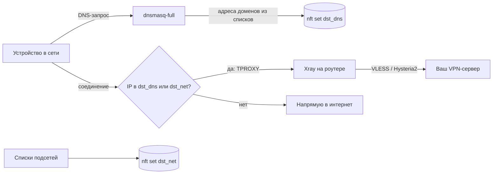

# luci-app-xroute

Приложение для OpenWrt: заблокированные и недоступные из России сайты и приложения идут через ваш VPN-сервер на Xray (VLESS, Hysteria2), всё остальное — напрямую. Устройствам в сети ничего настраивать не нужно: ни VPN-приложений, ни прокси.

Управление — в LuCI на русском: **Службы → VPN-маршрутизация**.

- Через VPN идут только сайты из выбранных списков (Telegram, WhatsApp, Instagram, ChatGPT, Claude, Viber, украинские сервисы и т.д.) и ваши домены и подсети.
- Серверы: ссылки `vless://`, `hy2://`, `hysteria2://` и подписки 3x-ui.
- Автовыбор самого быстрого живого сервера; если все серверы недоступны, сайты идут напрямую.
- Обход ТСПУ: начало TLS-соединения с VPN-сервером (ClientHello) нарезается на мелкие части, и провайдер не может его разобрать и оборвать.
- После пропадания интернета (отключение света, переподключение PPPoE) серверы перепроверяются сразу, не дожидаясь очередной проверки.
- Хорошо работает рядом с [zapret](https://github.com/remittor/zapret-openwrt): что можно открыть обходом DPI — открывает zapret, что заблокировано по IP или само не пускает из РФ — идёт через VPN.
- Почти не пишет на флешку: списки, журналы и состояние живут в оперативной памяти.

## Как это работает



1. **Списки доменов** превращаются в правила `nftset=` для dnsmasq-full. Когда устройство спрашивает у роутера адрес, например, `chatgpt.com`, dnsmasq кладёт полученные IP в набор `dst_dns` (на сутки).
2. **Списки подсетей** (Telegram, Meta, X, Viber) загружаются в набор `dst_net` сразу. Они работают даже без DNS роутера.
3. **nftables** (таблица `inet xroute`, цепочка prerouting) перехватывает только трафик из LAN к адресам из этих наборов и передаёт его через TPROXY в Xray (`127.0.0.1:12701`). Используются метка `0x2000` и таблица маршрутизации `127`. Частные сети и адреса самих VPN-серверов не перехватываются никогда.
4. **Xray** определяет имя сайта (sniffing HTTP/TLS/QUIC) и отправляет соединение на выбранный сервер или в балансировщик `leastPing`. Балансировщик раз в минуту проверяет серверы и выбирает самый быстрый. Если не отвечает ни один, срабатывает `fallback` напрямую.
5. **Сторож** (`check.sh`, раз в минуту по cron): если Xray остановился, перехват снимается, и сайты идут напрямую (и через zapret, если он стоит). Когда Xray снова работает, перехват возвращается.
6. **Подъём WAN** (`/etc/hotplug.d/iface/95-xroute`): когда интернет появляется снова, служба перезапускается. Xray сразу перепроверяет серверы, а не ждёт следующего интервала, а списки и подписки скачиваются заново. Перезапуск не трогает dnsmasq и не очищает уже набранные адреса.

Всё, чего нет в списках, роутер не трогает: оно идёт обычным путём, с максимальной скоростью.

## Протоколы

| Протокол | Что поддерживается |
| --- | --- |
| VLESS | транспорты RAW (TCP), XHTTP, WebSocket, gRPC; защита REALITY (pbk, sid, spx, fp, pqv) или TLS; flow `xtls-rprx-vision`; VLESS Encryption (`mlkem768x25519plus…`); параметры 3x-ui `extra` (XHTTP) и `fm` (finalmask) |
| Hysteria2 | ссылки `hy2://` и `hysteria2://`; TLS с `sni`, `alpn`, `pinSHA256`; маскировка salamander; смена портов (диапазон в ссылке или `mport`) |
| Подписки | 3x-ui и совместимые: base64 или список ссылок; трафик, срок и название из заголовков `subscription-userinfo`, `profile-title`, `profile-update-interval`; фильтр серверов по названию |

Не поддерживаются VMess, Trojan, Shadowsocks, WireGuard, TUIC: такие серверы из подписки пропускаются, а добавленные вручную показываются на странице «Состояние» с пометкой «не поддерживается».

## Обход ТСПУ

Многие провайдеры обрывают новые соединения с зарубежными серверами: TCP-соединение устанавливается, но первый пакет с данными — TLS ClientHello — до сервера не доходит. Так блокируются и VPN, и панель 3x-ui, при этом уже открытые соединения продолжают работать. Поэтому VPN может долго не подниматься после перезагрузки роутера, хотя на ПК всё работает.

Пакет по умолчанию нарезает ClientHello на куски по 10–30 байт с паузами 5–10 мс (`finalmask` → `fragment` в Xray 26). На проверенном провайдере это дало 8 успешных подключений из 8 против 0 из 8 без нарезки, а подключение заняло ~0,25 с. Нарезка включается в «Серверы → Нарезать TLS-приветствие» и действует на VLESS с REALITY или TLS. Если в ссылке есть свой параметр `fm`, используется он.

Hysteria2 работает поверх QUIC (UDP), и нарезка ему не помогает. Если провайдер отбрасывает QUIC к вашему серверу, включите в 3x-ui для Hysteria2 маскировку **salamander**: ссылка получит `obfs=salamander`, и пакет её поддерживает.

Подписка тоже скачивается в обход: если панель не отвечает напрямую, запрос идёт через Xray.

## Особенности Xray 26

- `allowInsecure` в Xray 26 запрещён: такая настройка не даёт ему запуститься. Для самоподписанного сертификата укажите в ссылке отпечаток `pinSHA256` (в 3x-ui он подставляется сам). Без отпечатка сертификат проверяется как обычно.
- Если один сервер из списка или подписки Xray не принимает, этот сервер пропускается, а остальные работают. Причину видно на странице «Состояние».

## Требования

| Что | Зачем |
| --- | --- |
| OpenWrt 25.12 или новее (менеджер пакетов apk, firewall4/nftables) | проверено на 25.12.6 x86_64; пакет не зависит от архитектуры, нужен только xray-core для вашей платформы |
| `xray-core` ≥ 26.3.27 | сам VPN-клиент; около 31 МБ на флешке и 60–70 МБ оперативной памяти |
| `dnsmasq-full` | обычный dnsmasq не умеет заполнять наборы nftables |
| `kmod-nft-tproxy` | перехват TCP и UDP через TPROXY |
| `curl`, `ucode`, `ucode-mod-uci`, `ucode-mod-fs` | загрузка списков и подписок, сборка настроек Xray |
| `luci-base` | веб-интерфейс |

Все зависимости ставятся из официального репозитория OpenWrt автоматически, кроме замены dnsmasq на dnsmasq-full (см. ниже).

## Установка

Команды выполняются на роутере по SSH.

**1. Ключ, которым подписаны пакеты этого репозитория.**

```sh
wget -O /etc/apk/keys/luci-app-xroute.pem https://github.com/Rozsario/luci-app-xroute/releases/latest/download/luci-app-xroute.pem
```

**2. dnsmasq → dnsmasq-full.** Пакет скачивается заранее: после удаления dnsmasq роутер остаётся без DNS и уже ничего не скачает.

```sh
apk update
cd /tmp && apk fetch dnsmasq-full
apk del dnsmasq && apk add --allow-untrusted /tmp/dnsmasq-full-*.apk
```

**3. Репозиторий и сам пакет.**

```sh
echo "https://github.com/Rozsario/luci-app-xroute/releases/latest/download/packages.adb" >> /etc/apk/repositories.d/customfeeds.list
apk update && apk add luci-app-xroute
```

Обновления дальше приходят как обычные: `apk update && apk upgrade luci-app-xroute` или через «Система → Пакеты».

## Настройка

1. **Службы → VPN-маршрутизация → Серверы.** Добавьте ссылку на сервер или подписку 3x-ui и включите службу.
2. **Списки.** Отметьте нужные готовые списки. При необходимости добавьте свои домены (с поддоменами; `ua` — вся зона) и подсети. В «Никогда не через VPN» укажите то, что должно идти мимо VPN.
3. **Состояние.** Нажмите «Проверить серверы»: у каждого сервера должно быть «работает, N мс».

Чтобы маршрутизация по доменам работала, устройства должны спрашивать DNS у роутера:

- на Android выключите «Частный DNS»;
- в браузерах выключите «Безопасный DNS» (DNS over HTTPS);
- в iCloud отключите «Частный узел» (Private Relay).

Подсети (Telegram, Meta, X, Viber) работают и без этого.

**IPv6.** Перехватывается только IPv4. Если в сети раздаётся IPv6, сайты с IPv6-адресами пойдут мимо VPN. Выключите IPv6 для LAN или отфильтруйте AAAA-записи в dnsmasq.

**Гостевые сети.** Перехватывается трафик интерфейса `lan`; другие интерфейсы идут напрямую.

**Вместе с zapret.**

- Добавьте IP своих VPN-серверов в исключения zapret по IP (`zapret-ip-user-exclude.txt`), чтобы zapret не искажал само VPN-соединение.
- По умолчанию YouTube и Discord стоят в «Никогда не через VPN»: zapret обычно открывает их быстрее, чем VPN. Если zapret нет, уберите их оттуда.

## Готовые списки

| Список | Что внутри | Источник |
| --- | --- | --- |
| Telegram | домены и подсети | itdoginfo |
| WhatsApp, Instagram, Facebook | домены и подсети Meta | itdoginfo |
| Viber | домены и собственные сети Viber (52.0.252.0/22, 185.117.96.0/24) | этот репозиторий |
| Украина | вся зона `.ua` и `.укр` (банки, Дія и gov.ua, Нова пошта, Укрпошта, магазины, операторы) и украинские сервисы вне `.ua` (ukr.net, Meest, Megogo, Sweet.tv, новости) | этот репозиторий |
| Сервисы с блокировкой по стране | ChatGPT, Claude, Grok, Notion, Spotify, Netflix, JetBrains, Canva и другие сайты, которые сами не пускают из РФ (~465 доменов) | itdoginfo |
| Google AI | Gemini, AI Studio, NotebookLM | itdoginfo |
| X (Twitter), TikTok, Roblox, HDRezka, Discord, YouTube | домены сервиса (у X, Discord и Roblox — и подсети) | itdoginfo |
| Заблокированные новостные сайты, прочие заблокированные сайты | категории itdoginfo | itdoginfo |
| Всё заблокированное в РФ | большой общий список (~1200 доменов) | itdoginfo |

По умолчанию включены Telegram, Meta, сервисы с блокировкой по стране и Google AI.

Списки скачиваются в оперативную память при запуске и обновляются 1-го и 15-го числа. Если загрузка не удалась, для Telegram, Meta, Viber, Украины, сервисов с блокировкой по стране и Google AI используются копии, встроенные в пакет, а загрузка повторяется каждые 30 секунд. Списки этого репозитория лежат в [`lists/`](lists): правки и новые сервисы — через issue или pull request.

## Рекомендации

- **Два сервера разных типов** (например, VLESS XHTTP REALITY и Hysteria2) и режим «Автоматически»: если один заблокируют или он упадёт, трафик сам уйдёт на другой.
- **Hysteria2 с `pinSHA256`** вместо «insecure»: так соединение защищено от подмены сертификата. С маскировкой salamander его не отличить от случайного UDP-трафика.
- **Подписка 3x-ui** удобнее отдельных ссылок: новые серверы и смена ключей подхватываются сами. Ссылки подписки хранятся на флешке и перезаписываются только при реальных изменениях, поэтому после перезагрузки роутер работает и без доступа к панели.
- **Не добавляйте в VPN-списки целые CDN** (Cloudflare, Amazon, Akamai): через VPN пойдёт половина интернета.
- **Проверяйте результат на странице «Состояние»:** счётчик «Через VPN прошло» должен расти, когда вы открываете сайт из списка.

## Ограничения

- Собственный трафик роутера (обновления пакетов и т.п.) через VPN не идёт.
- Маршрутизация по доменам идёт по IP-адресам из ответов DNS. Если на одном IP сидят сайт из списка и посторонний сайт (общий CDN), посторонний тоже пойдёт через VPN, пока адрес в наборе.
- Если клиент ходит в DNS мимо роутера (DoH, «Частный DNS»), доменные списки для него не работают.

## Диагностика

```sh
/usr/share/xroute/status.uc test | jsonfilter -e '@.servers[*]'   # серверы и их проверка
logread -e xroute                                                  # журнал службы (в памяти)
nft list table inet xroute | head -n 30                            # правила и наборы
cat /tmp/xroute/lists.info                                         # сколько доменов и подсетей загружено
```

## Сборка из исходников

Нужен [OpenWrt SDK](https://downloads.openwrt.org/releases/) 25.12 для любой архитектуры:

```sh
cp -r luci-app-xroute <sdk>/package/
cd <sdk>
make defconfig
make package/luci-app-xroute/compile V=s
```

Готовый `.apk` появится в `bin/packages/*/base/`. Чтобы apk v3 доверял пакету, его нужно подписать своим ключом через индекс: `apk mkndx --sign-key …`.

## Источники

- [itdoginfo/allow-domains](https://github.com/itdoginfo/allow-domains) — готовые списки доменов и подсетей. Пакет скачивает их напрямую, а несколько списков содержит как запасную копию.
- [v2fly/domain-list-community](https://github.com/v2fly/domain-list-community) (MIT) — домены Viber.
- Whois [RIPE](https://stat.ripe.net/) и ARIN — сети Viber (IL-VIBER, AWS-VIBER-MEDIA).
- [XTLS/Xray-core](https://github.com/XTLS/Xray-core) (MPL-2.0) — VPN-клиент; пакет `xray-core` из репозитория OpenWrt.
- [MHSanaei/3x-ui](https://github.com/MHSanaei/3x-ui) — формат ссылок и подписок, с которыми совместим пакет.
- [OpenWrt](https://openwrt.org/) и [LuCI](https://github.com/openwrt/luci) — dnsmasq-full, nftables, ucode, procd.
- [remittor/zapret-openwrt](https://github.com/remittor/zapret-openwrt) и [bol-van/zapret2](https://github.com/bol-van/zapret2) — zapret для OpenWrt, рядом с которым проверялась работа.

## Лицензия

Некоммерческая — полный текст в [LICENSE](LICENSE). Коротко:

- можно бесплатно использовать, копировать и распространять пакет и списки;
- можно изменять любые файлы и списки и распространять изменённые версии — с этой же лицензией и указанием автора;
- нельзя монетизировать: продавать, брать плату за доступ, установку или настройку, включать в платные продукты и сервисы (в том числе платные VPN и роутеры на продажу), размещать рекламу.

Сторонние списки и программы — на условиях их авторов.
