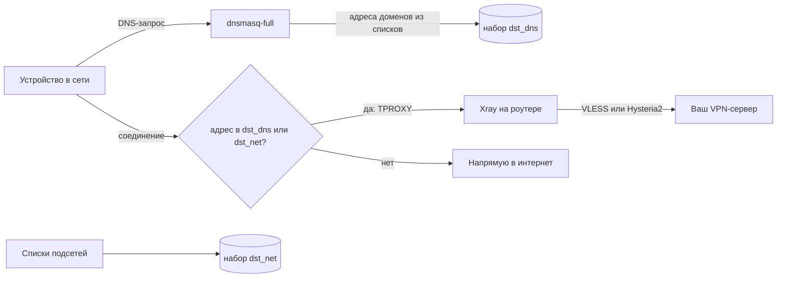

# luci-app-xroute

**luci-app-xroute** — приложение для роутеров на OpenWrt, которое отправляет через ваш VPN-сервер только то, что без него не открывается: заблокированные сервисы и сервисы, которые сами не пускают пользователей из России. Всё остальное идёт напрямую, на полной скорости. VPN работает на роутере, поэтому устройствам в сети ничего настраивать не нужно.

VPN-клиент — [Xray](https://github.com/XTLS/Xray-core): поддерживаются VLESS (в том числе REALITY и XHTTP), Hysteria2 и подписки 3x-ui. Управление — в LuCI на русском языке, в разделе **Службы → VPN-маршрутизация**.

## Возможности

- **Маршрутизация по спискам.** Через VPN идут только сайты из выбранных готовых списков (Telegram, WhatsApp, Instagram, ChatGPT, Claude, Viber, украинские сервисы и другие) и ваши собственные домены и подсети. YouTube и Google Play одним переключателем отправляются через VPN или остаются на zapret.
- **Серверы и подписки.** Принимаются ссылки `vless://`, `hy2://`, `hysteria2://` и подписки 3x-ui. Из нескольких серверов автоматически выбирается самый быстрый из работающих.
- **Обход ТСПУ.** Начало защищённого соединения с VPN-сервером нарезается на мелкие части, и оборудование провайдера не может его распознать и оборвать.
- **Отказоустойчивость.** Если VPN-серверы недоступны или Xray остановился, сайты из списков идут напрямую, и сеть продолжает работать. После пропадания интернета, например при отключении света, серверы перепроверяются сразу, как только связь вернётся.
- **Совместимость с zapret и VPN-клиентами на устройствах.** Трафик к вашим VPN-серверам роутер никогда не заворачивает в свой VPN и не отдаёт zapret. Поэтому ПК с v2rayN или телефон с собственным VPN-клиентом подключаются к тому же серверу без помех.
- **Бережное отношение к флешке.** Списки, журналы и состояние хранятся в оперативной памяти. На флешку записываются только настройки и последняя рабочая копия подписки, и только при изменении.

## Как это работает



1. **Домены.** Списки доменов превращаются в правила `nftset` для dnsmasq-full. Когда устройство спрашивает у роутера адрес, например, `chatgpt.com`, dnsmasq добавляет полученные IP-адреса в набор `dst_dns` на сутки.
2. **Подсети.** Подсети Telegram, Meta, X и Viber сразу загружаются в набор `dst_net` и работают независимо от DNS.
3. **Перехват.** Правила nftables (таблица `inet xroute`) перехватывают только соединения из LAN к адресам из этих наборов и передают их через TPROXY в Xray. Частные сети и адреса самих VPN-серверов не перехватываются никогда.
4. **Выбор сервера.** Xray определяет имя сайта по началу соединения (HTTP, TLS, QUIC) и отправляет его на выбранный сервер или на самый быстрый из работающих. Серверы проверяются раз в минуту. Если не отвечает ни один, соединение идёт напрямую.
5. **Сторож.** Раз в минуту проверяется, работает ли Xray. Если нет, перехват снимается, и сайты из списков идут напрямую (и через zapret, если он установлен). Когда Xray снова запущен, перехват возвращается.
6. **Возврат связи.** Когда интерфейс WAN поднимается снова, служба перезапускается через 5 секунд. Xray сразу перепроверяет серверы, а списки и подписки скачиваются заново. Перезапуск не трогает dnsmasq и не очищает уже собранные адреса.

## Протоколы

| Протокол | Что поддерживается |
| --- | --- |
| VLESS | транспорты RAW (TCP), XHTTP, WebSocket, gRPC; защита REALITY (`pbk`, `sid`, `spx`, `fp`, `pqv`) или TLS; flow `xtls-rprx-vision`; VLESS Encryption (`mlkem768x25519plus…`); параметры 3x-ui `extra` (XHTTP) и `fm` (finalmask) |
| Hysteria2 | ссылки `hy2://` и `hysteria2://`; TLS с `sni`, `alpn` и `pinSHA256`; маскировка salamander; смена портов (диапазон в ссылке или параметр `mport`) |
| Подписки | 3x-ui и совместимые: base64 или список ссылок; трафик, срок действия и название из заголовков `subscription-userinfo`, `profile-title`, `profile-update-interval`; фильтр серверов по названию |

VMess, Trojan, Shadowsocks, WireGuard и TUIC не поддерживаются. Такие серверы из подписки пропускаются, а добавленные вручную отмечаются на странице «Состояние» как неподдерживаемые.

Xray 26 не запускается с настройкой `allowInsecure`, поэтому пакет её не использует. Для самоподписанного сертификата укажите в ссылке его отпечаток `pinSHA256` (3x-ui подставляет его сам). Если Xray отвергает отдельный сервер, этот сервер пропускается, а остальные продолжают работать. Причина видна на странице «Состояние».

## Обход ТСПУ

Многие провайдеры обрывают новые соединения с зарубежными серверами: TCP-соединение устанавливается, но первый пакет с данными — TLS ClientHello — до сервера не доходит. Под удар попадают и VPN, и панель 3x-ui, а уже открытые соединения продолжают работать. Поэтому после перезагрузки роутера VPN может долго не подниматься, хотя на ПК, где соединение было открыто раньше, всё работает.

Пакет по умолчанию нарезает ClientHello на куски по 10–30 байт с паузами 5–10 мс (механизм `finalmask` → `fragment` в Xray 26). У провайдера, на котором проверялся пакет, без нарезки не прошло ни одно из 8 подключений, с нарезкой прошли все 8, по 0,25 с каждое. Нарезка включается флажком **Серверы → Нарезать TLS-приветствие** и действует на VLESS с REALITY или TLS. Если в ссылке есть собственный параметр `fm`, используется он.

Hysteria2 работает поверх QUIC (UDP), и нарезка ему не помогает. Если провайдер отбрасывает QUIC к вашему серверу, включите в 3x-ui для Hysteria2 маскировку **salamander**: в ссылке появится `obfs=salamander`, и пакет подхватит её автоматически.

Подписка скачивается в обход тем же способом: если панель не отвечает напрямую, запрос идёт через Xray.

## Требования

| Компонент | Назначение |
| --- | --- |
| OpenWrt 25.12 или новее (менеджер пакетов apk, firewall4) | проверено на 25.12.6 x86_64; сам пакет не зависит от архитектуры |
| `xray-core` 26.3.27 или новее | VPN-клиент; около 31 МБ на флешке и 60–70 МБ оперативной памяти |
| `dnsmasq-full` | обычный dnsmasq не умеет добавлять адреса в наборы nftables |
| `kmod-nft-tproxy` | перехват TCP и UDP |
| `curl`, `ucode`, `ucode-mod-uci`, `ucode-mod-fs` | загрузка списков и подписок, сборка настроек Xray |
| `luci-base` | веб-интерфейс |

Все зависимости, кроме `dnsmasq-full`, ставятся из официального репозитория OpenWrt автоматически.

## Установка

Команды выполняются на роутере по SSH.

**1. Ключ, которым подписаны пакеты.**

```sh
wget -O /etc/apk/keys/luci-app-xroute.pem https://github.com/Rozsario/luci-app-xroute/releases/latest/download/luci-app-xroute.pem
```

**2. Замена dnsmasq на dnsmasq-full.** Пакет скачивается заранее: после удаления dnsmasq роутер остаётся без DNS и уже ничего не скачает.

```sh
apk update
cd /tmp && apk fetch dnsmasq-full
apk del dnsmasq && apk add --allow-untrusted /tmp/dnsmasq-full-*.apk
```

**3. Репозиторий и пакет.**

```sh
echo "https://github.com/Rozsario/luci-app-xroute/releases/latest/download/packages.adb" >> /etc/apk/repositories.d/customfeeds.list
apk update && apk add luci-app-xroute
```

Новые версии ставятся как обычные обновления: командой `apk update && apk upgrade luci-app-xroute` или в LuCI через **Система → Пакеты**.

## Настройка

1. Откройте **Службы → VPN-маршрутизация → Серверы**, добавьте ссылку на сервер или подписку 3x-ui и включите службу.
2. На вкладке **Списки** отметьте нужные готовые списки. Там же можно добавить свои домены (вместе с поддоменами; `ua` означает всю зону) и подсети, а в поле «Никогда не через VPN» — то, что должно идти мимо VPN.
3. На вкладке **Состояние** нажмите «Проверить серверы»: у каждого сервера должно быть написано «работает» и время отклика.

**DNS на устройствах.** Домены из списков работают, только если устройство спрашивает DNS у роутера. Выключите «Частный DNS» на Android, «Безопасный DNS» (DNS over HTTPS) в браузерах и «Частный узел» (Private Relay) в iCloud. Подсети работают и без этого.

**IPv6.** Перехватывается только IPv4. Если в сети раздаётся IPv6, сайты с IPv6-адресами пойдут мимо VPN. Выключите IPv6 для LAN или запретите в dnsmasq ответы с IPv6-адресами (AAAA).

**Гостевые сети.** Перехватывается трафик интерфейса `lan`. Устройства в других сетях выходят в интернет напрямую.

## Совместная работа с zapret и VPN-клиентами

Пакет рассчитан на работу рядом с [zapret](https://github.com/remittor/zapret-openwrt): то, что можно открыть обходом DPI, открывает zapret, а то, что заблокировано по IP или не пускает из России, идёт через VPN.

- **Трафик к VPN-серверам не трогается.** Адреса серверов из настроек и подписок собираются в отдельный набор: при запуске и каждый раз, когда кто-то в сети запрашивает адрес сервера в DNS. Соединения с этими адресами роутер не перехватывает. Ещё они получают метку, по которой zapret их пропускает: роутер берёт её из настроек zapret (`DESYNC_MARK`), вручную добавлять серверы в исключения zapret не нужно.
- **VPN-клиенты на устройствах.** ПК с v2rayN или телефон с Hiddify подключаются к тому же серверу напрямую, без двойного туннеля и без вмешательства zapret. Клиента на устройстве ТСПУ может обрывать так же, как роутер. Если подключение не устанавливается, включите в нём фрагментацию ClientHello (fragment), если клиент её поддерживает.
- **Другие серверы.** Если устройство подключается к серверу, которого нет в настройках роутера, добавьте IP этого сервера в исключения zapret по IP (`zapret-ip-user-exclude.txt`).
- **YouTube и Discord.** По умолчанию они стоят в поле «Никогда не через VPN»: zapret обычно открывает их быстрее. Если zapret не установлен, включите «YouTube и Google Play через VPN» и уберите Discord из исключений.
- **Проверенная сборка.** Совместная работа проверялась с zapret2 от remittor ([remittor/zapret-openwrt](https://github.com/remittor/zapret-openwrt)). Метку `DESYNC_MARK` роутер берёт из настроек `zapret2` или `zapret`; с другими сборками zapret это не проверялось.

## Готовые списки

| Список | Что внутри | Источник |
| --- | --- | --- |
| Telegram | домены и подсети | itdoginfo |
| WhatsApp, Instagram, Facebook | домены и подсети Meta | itdoginfo |
| Viber | домены и собственные сети Viber (52.0.252.0/22, 185.117.96.0/24) | этот репозиторий |
| Украина | вся зона `.ua` и `.укр` (банки, Дія и gov.ua, Нова пошта, Укрпошта, магазины, операторы) и украинские сервисы вне `.ua` (ukr.net, Meest, Megogo, Sweet.tv, новости) | этот репозиторий |
| Сервисы с блокировкой по стране | ChatGPT, Claude, Grok, Notion, Spotify, Netflix, JetBrains, Canva и другие сервисы, которые сами не пускают из России (~465 доменов) | itdoginfo |
| Google AI | Gemini, AI Studio, NotebookLM | itdoginfo |
| YouTube и Google Play | включаются вместе переключателем «YouTube и Google Play через VPN» (см. ниже) | itdoginfo |
| X (Twitter), TikTok, Roblox, HDRezka, Discord | домены сервиса, у X, Discord и Roblox — ещё и подсети | itdoginfo |
| Заблокированные новостные сайты, прочие заблокированные сайты | категории itdoginfo | itdoginfo |
| Всё заблокированное в России | большой общий список (~1200 доменов) | itdoginfo |

По умолчанию включены Telegram, Meta, сервисы с блокировкой по стране и Google AI.

### YouTube и Google Play

На вкладке «Списки» есть переключатель **YouTube и Google Play через VPN**:

- **Выключен** (по умолчанию). YouTube и Google Play идут через zapret. Видео обычно быстрее, но у многих провайдеров загрузки из Google Play зависают или обрываются: сервер отдаёт первые десятки мегабайт, после чего провайдер душит соединение.
- **Включён.** Все домены YouTube и Google Play идут через VPN. Загрузки из Play работают, а видео идёт со скоростью вашего VPN-сервера.

Видео YouTube и загрузки Play Google отдаёт с одних и тех же серверов (`googlevideo.com` и `gvt1.com` на одних адресах), поэтому раздельно их не переключить. Подсетей у YouTube и Play тоже нет: их адреса общие со всем Google, а кеш-серверы Google стоят внутри сетей провайдеров. Поэтому маршрутизация идёт по доменам, а поиск, почта и карты Google продолжают идти напрямую.

Настройки zapret переключатель не трогает, и это не нужно. Трафик, который роутер отправляет в VPN, перехватывается раньше, чем до него доходит zapret. Если выключить переключатель или если VPN перестанет работать, YouTube снова подхватит zapret. При выключении адреса, собранные для YouTube, сразу убираются из VPN и не ждут суток. Проверено с zapret2 от remittor ([remittor/zapret-openwrt](https://github.com/remittor/zapret-openwrt)); с другими сборками zapret не проверялось.

Списки скачиваются в оперативную память при запуске службы и обновляются 1-го и 15-го числа каждого месяца. Если загрузка не удалась, для Telegram, Meta, Viber, Украины, сервисов с блокировкой по стране и Google AI используются копии, встроенные в пакет, а загрузка повторяется каждые 30 секунд. Списки этого репозитория лежат в папке [`lists/`](lists). Исправления и новые сервисы можно предложить через issue или pull request.

## Рекомендации

- **Держите два сервера разных типов**, например VLESS XHTTP с REALITY и Hysteria2 с salamander, и оставьте автоматический выбор. Если один сервер заблокируют или он перестанет отвечать, трафик сам перейдёт на другой.
- **Для Hysteria2 используйте `pinSHA256`**, а не «insecure»: отпечаток защищает соединение от подмены сертификата.
- **Подключайте подписку 3x-ui, а не отдельные ссылки.** Новые серверы и смена ключей подхватятся сами. Подписка хранится на роутере, поэтому после перезагрузки VPN работает, даже если панель недоступна.
- **Не добавляйте в VPN целые CDN** (Cloudflare, Amazon, Akamai): через VPN пойдёт заметная часть интернета.
- **Проверяйте результат на странице «Состояние».** Счётчик «Через VPN прошло» должен расти, когда вы открываете сайт из списка.

## Ограничения

- Собственный трафик роутера (обновление пакетов и т. п.) через VPN не идёт.
- Маршрутизация по доменам работает по IP-адресам из ответов DNS. Если сайт из списка и посторонний сайт находятся на одном адресе (общий CDN), посторонний тоже пойдёт через VPN, пока адрес остаётся в наборе.
- Если устройство обращается к DNS в обход роутера (DNS over HTTPS, «Частный DNS»), доменные списки для него не работают.

## Диагностика

```sh
/usr/share/xroute/status.uc test | jsonfilter -e '@.servers[*]'   # серверы и результат проверки
logread -e xroute                                                  # журнал службы (в оперативной памяти)
nft list table inet xroute | head -n 40                            # правила и наборы адресов
cat /tmp/xroute/lists.info                                         # сколько доменов и подсетей загружено
```

## Сборка из исходников

Нужен [OpenWrt SDK](https://downloads.openwrt.org/releases/) версии 25.12 для любой архитектуры:

```sh
cp -r luci-app-xroute <sdk>/package/
cd <sdk>
make defconfig
make package/luci-app-xroute/compile V=s
```

Готовый пакет появится в `bin/packages/*/base/`. Менеджер apk v3 доверяет пакетам через подписанный индекс, поэтому для установки соберите индекс и подпишите его своим ключом: `apk mkndx --sign-key <ключ> …`.

## Источники

| Источник | Что взято |
| --- | --- |
| [itdoginfo/allow-domains](https://github.com/itdoginfo/allow-domains) | готовые списки доменов и подсетей; пакет скачивает их напрямую, а несколько списков хранит как запасные копии |
| [v2fly/domain-list-community, data/viber](https://github.com/v2fly/domain-list-community/blob/master/data/viber) (MIT) | домены Viber |
| [RIPE: 185.117.96.0/24](https://stat.ripe.net/185.117.96.0/24) и [ARIN: 52.0.252.0/22](https://search.arin.net/rdap/?query=52.0.252.0) | собственные сети Viber (IL-VIBER, AWS-VIBER-MEDIA) |
| [XTLS/Xray-core](https://github.com/XTLS/Xray-core) (MPL-2.0), [документация Xray](https://xtls.github.io/) | VPN-клиент и формат его настроек; пакет `xray-core` берётся из репозитория OpenWrt |
| [MHSanaei/3x-ui](https://github.com/MHSanaei/3x-ui) | формат ссылок и подписок, с которыми совместим пакет |
| [OpenWrt](https://openwrt.org/), [LuCI](https://github.com/openwrt/luci), [ucode](https://github.com/jow-/ucode) | система, веб-интерфейс и язык скриптов пакета |
| [dnsmasq](https://thekelleys.org.uk/dnsmasq/doc.html), [nftables](https://netfilter.org/projects/nftables/) | заполнение наборов адресов по DNS и перехват трафика |
| [remittor/zapret-openwrt](https://github.com/remittor/zapret-openwrt), [bol-van/zapret2](https://github.com/bol-van/zapret2) | zapret для OpenWrt, совместно с которым проверялся пакет |

## Лицензия

Пакет распространяется по некоммерческой лицензии; полный текст — в файле [LICENSE](LICENSE). Коротко:

- пакет и списки можно бесплатно использовать, копировать и распространять;
- любые файлы и списки можно изменять и распространять изменённые версии — с той же лицензией и указанием автора;
- монетизировать нельзя: продавать, брать плату за доступ, установку или настройку, включать в платные продукты и сервисы (в том числе в платные VPN и роутеры на продажу), размещать рекламу.

Сторонние списки и программы распространяются на условиях их авторов.
